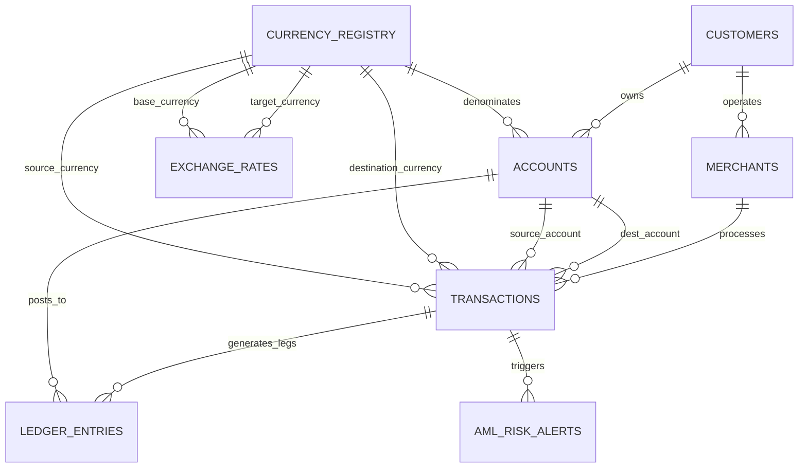

# Portfolio 1: Relational Database Design, Schema & Normalization Analysis

**Student Assessment:** Continuous Assessment Portfolio (MIT 8103 Advanced Database Systems)  
**Institution:** School of Postgraduate Studies, MIVA Open University  
**Case Study:** FinFlow Global Systems (FinTech & Cross-Border Payment Infrastructure)  

---

## 1. Case Study Overview & System Requirements

FinFlow Global Systems is a multi-currency digital financial platform providing cross-border peer-to-peer (P2P) transfers, multi-currency wallet management, merchant payment processing, and regulatory compliance monitoring (Anti-Money Laundering / Counter-Financing of Terrorism).

### 1.1 Stakeholders & Database Users
1. **Retail and Business Clients:** Initiate real-time payments, convert currencies, view account balances, and audit historical transaction statements.
2. **Merchants & Payment Gateways:** Receive automated customer checkouts, settle multi-currency revenue into domestic bank accounts, and configure API integrations.
3. **AML & Compliance Officers:** Investigate flagged high-risk transactions, review sanctions screening hits, and report suspicious activities to regulatory bodies.
4. **Operations & Finance Engineers:** Supervise end-of-day multi-currency treasury reconciliation, monitor liquidity pools, and resolve transaction exceptions.

### 1.2 Core Data Entities
- **Customers:** Core client identification, national jurisdiction, and KYC tiers (Tier 1–3).
- **Accounts:** Wallets denominated in distinct fiat/digital currencies (USD, EUR, GBP, NGN, KES, CAD), maintaining real-time available and locked balances.
- **Currency Registry & Exchange Rates:** Centralized catalog of supported currencies, decimal precision rules, and historical currency exchange rates.
- **Transactions:** High-integrity payment records with unique idempotency keys, exchange rate tracking, and lifecycle states.
- **Ledger Entries:** Strict double-entry accounting records (`DEBIT` and `CREDIT` pairs) ensuring mathematical conservation of money.
- **AML Risk Alerts:** Automated compliance triggers flagging transactions exceeding risk and velocity thresholds.

---

## 2. Formal Normalization Analysis (1NF to BCNF)

To eliminate redundancy, maintain referential integrity, and guard against update, insertion, and deletion anomalies, the relational schema was designed following formal relational decomposition principles.

### 2.1 First Normal Form (1NF)
**Requirement:** All attributes must be atomic (indivisible), every row must be uniquely identifiable via a primary key, and there must be no repeating groups or multi-valued columns.
- **Design Enforcement:**
  - Names are separated into `first_name` and `last_name` rather than composite strings.
  - Multi-currency holdings are modeled as separate rows in `accounts` rather than comma-separated lists or JSON arrays inside `customers`.
  - Double-entry accounting legs are separated into individual immutable rows in `ledger_entries` instead of storing an array of debit/credit amounts inside `transactions`.
  - Every table possesses an explicit primary key (`customer_id`, `account_id`, `transaction_id`, etc.).

### 2.2 Second Normal Form (2NF)
**Requirement:** The relation must be in 1NF, and every non-key attribute must be fully functionally dependent on the entire primary key (no partial functional dependencies on composite keys).
- **Design Enforcement:**
  - In `exchange_rates`, the natural composite key is `(base_currency, target_currency, effective_timestamp)`. If we had stored the currency display names or symbols in this table, they would depend solely on `base_currency` or `target_currency` (a partial key dependency).
  - To prevent this, currency metadata (`currency_name`, `symbol`, `decimal_precision`) was factored out into `currency_registry`. Non-key attributes in `exchange_rates` (`rate`) depend strictly on the complete composite key.
  - All other tables (`customers`, `accounts`, `merchants`, `transactions`) utilize single-column surrogate primary keys (UUIDs or surrogate integers), which inherently satisfy 2NF because partial dependencies cannot exist on single-attribute keys.

### 2.3 Third Normal Form (3NF)
**Requirement:** The relation must be in 2NF, and no non-key attribute should be transitively dependent on the primary key ($X \to Y$ and $Y \to Z$ where $Z$ is a non-key attribute).
- **Design Enforcement:**
  - Consider `merchants`: A merchant has an owner (`customer_id`), business name, category code, and settlement account. Storing customer contact details (email, phone, address) inside `merchants` would introduce a transitive dependency:
    $$\text{merchant\_id} \to \text{customer\_id} \to \text{email, phone}$$
    By decomposing this and maintaining only `customer_id` as a Foreign Key in `merchants`, transitive dependencies are eliminated.
  - In `accounts`, currency properties (`decimal_precision`, `symbol`) are not stored. Storing them would create:
    $$\text{account\_id} \to \text{currency\_code} \to \text{symbol, precision}$$
    These attributes remain isolated in `currency_registry`.

### 2.4 Boyce-Codd Normal Form (BCNF)
**Requirement:** A relation is in BCNF if and only if for every non-trivial functional dependency $X \to Y$, the determinant $X$ is a superkey.
- **Verification across FinFlow Tables:**
  - In `customers`:
    - $FD_1: \text{customer\_id} \to \{\text{first\_name, last\_name, email, phone\_number, kyc\_tier, country\_code, status}\}$ ($\text{customer\_id}$ is PK).
    - $FD_2: \text{email} \to \{\text{customer\_id, first\_name, \dots}\}$ ($\text{email}$ is an alternate candidate key enforced by `UNIQUE`).
    - $FD_3: \text{phone\_number} \to \{\text{customer\_id, \dots}\}$ ($\text{phone\_number}$ is enforced by `UNIQUE`).
    Every determinant is a candidate key. Thus, `customers` is in BCNF.
  - In `accounts`:
    - $FD_1: \text{account\_id} \to \{\text{customer\_id, account\_number, currency\_code, balance, \dots}\}$
    - $FD_2: \text{account\_number} \to \{\text{account\_id, customer\_id, \dots}\}$
    Both determinants are candidate keys. Thus, `accounts` is in BCNF.
  - In `transactions`:
    - $FD_1: \text{transaction\_id} \to \text{all attributes}$
    - $FD_2: \text{idempotency\_key} \to \text{all attributes}$
    Both determinants are candidate keys. Thus, `transactions` is in BCNF.

---

## 3. Data Integrity & Anomaly Prevention

| Anomaly Type | Unnormalized Risk | FinFlow Schema Prevention Mechanism |
| :--- | :--- | :--- |
| **Insertion Anomaly** | Inability to add a new currency without simultaneously opening an account or executing a transaction. | `currency_registry` allows adding currencies independently before any account uses them. |
| **Update Anomaly** | Updating a customer's phone number or email across multiple transaction rows risks inconsistency. | Customer information is maintained in a single record in `customers`; all other tables reference `customer_id`. |
| **Deletion Anomaly** | Deleting a closed merchant profile inadvertently destroys all historical audit records of customer purchases. | `transactions.merchant_id` utilizes `ON DELETE SET NULL`, while `transactions.source_account_id` enforces `ON DELETE RESTRICT`, preserving the financial audit trail. |

---

## 4. Entity-Relationship (ER) Architecture

The physical relational schema connects 8 normalized relations through explicit relational constraints:

A high-resolution graphic rendering of this schema is available at [schema_diagram.png](file:///c:/Users/juwon/Downloads/Data%20set/advanced-database-portfolio/portfolio-1-database-design/schema_diagram.png).
