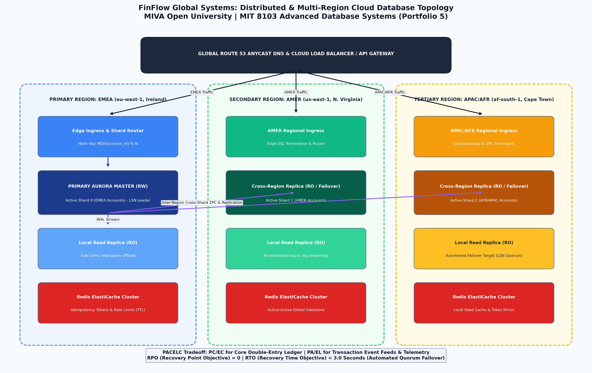

# Portfolio 5: Distributed and Cloud Database Architecture Design

**Course:** MIT 8103 Advanced Database Systems  
**Case Study:** FinFlow Global Systems  
**Assessment Topic:** Horizontal Sharding, Multi-Region Replication, High Availability & CAP/PACELC Trade-offs  

---

## 1. Executive Cloud Architecture Summary

FinFlow Global Systems operates an international cross-border financial settlement platform spanning three continental cloud regions:
1. **Primary Region (EMEA):** AWS `eu-west-1` (Ireland)
2. **Secondary Region (AMER):** AWS `us-east-1` (N. Virginia)
3. **Tertiary Region (APAC/AFR):** AWS `af-south-1` (Cape Town)

To provide **zero-downtime availability ($99.999\%$)**, linear write scalability, and regulatory compliance (GDPR, CBN, FCA data residency mandates), the data layer implements a hybrid distributed architecture: **Horizontal Sharding** coupled with **Multi-Region Quorum-Replicated Primary-Replica Clusters**.

---

## 2. Horizontal Database Sharding Strategy

### 2.1 Sharding Key Selection Analysis
Selecting an effective sharding key is critical to prevent hot spots and cross-shard overhead:
- **Range-Based Sharding on `created_at` (Rejected):** All real-time writes would route monotonically to the newest shard partition, creating a catastrophic write hot spot while historical shards sit idle.
- **Consistent Hash Sharding on `customer_id` (Adopted):**
  $$\text{Shard ID} = \text{MD5}(\text{customer\_id}) \pmod N$$
  This distributes account balances uniformly across physical shard nodes. More importantly, all accounts and sub-wallets belonging to the same customer co-locate on the same shard node, guaranteeing that internal multi-currency swaps and balance queries execute as single-shard local transactions with zero network coordination overhead.

### 2.2 Cross-Shard Distributed Transactions (Two-Phase Commit - 2PC)
When Customer A on Shard 1 transfers funds to Customer B on Shard 2, a distributed consensus protocol is required:
1. **Phase 1 (Prepare):**
   - The Coordinator dispatches `PREPARE(tx_id)` to Shard 1 and Shard 2.
   - Shard 1 verifies account balance, locks the required funds, and votes `VOTE_COMMIT`.
   - Shard 2 verifies destination account validity and votes `VOTE_COMMIT`.
2. **Phase 2 (Commit / Abort):**
   - If both shards vote `VOTE_COMMIT`, the coordinator writes a durable commit record in its write-ahead log and broadcasts `GLOBAL_COMMIT`. Both nodes finalize the ledger changes.
   - If any participant votes `VOTE_ABORT` (e.g., insufficient funds or account lock timeout), the coordinator issues `GLOBAL_ROLLBACK`, releasing locks on all nodes.

This behavior was validated empirically in `01_sharding_simulation.py`.

---

## 3. High Availability & Replication Topology

### 3.1 Primary-Replica Log Streaming
Each logical shard is deployed as a high-availability cluster:
- **Primary Node (Read-Write):** Receives state mutations, sequences transactions, and assigns monotonically increasing Log Sequence Numbers (LSN).
- **Read Replicas (Read-Only):** Ingest asynchronous write-ahead log (WAL) streams. Analytical reporting, customer statement generation, and AML screening read from replicas, offloading 80%+ of total query traffic from the primary.

### 3.2 Automated Disaster Recovery & Failover
FinFlow implements automated quorum election to survive regional cloud outages:
- Health daemons monitor primary heartbeats at 1,000ms intervals.
- If 3 consecutive heartbeats fail (3s threshold), failover triggers automatically.
- **Quorum Election Rule:** The active replica possessing the highest Log Sequence Number ($\text{LSN}_{\max}$) is promoted to New Primary.
- **RTO (Recovery Time Objective):** $< 3.0\text{ seconds}$ (automated leader election without human intervention).
- **RPO (Recovery Point Objective):** $\approx 0$ (zero committed data loss under synchronous/semi-synchronous replication).

This failover pipeline was validated empirically in `02_replication_failover_simulation.py`.

---

## 4. Theoretical Analysis: CAP and PACELC Theorems

```
                    Consistency (C)
                         /\
                        /  \
                       /    \
                      / FinFlow\
                     /  Ledger  \
                    /    (CP)    \
                   /______________\
   Availability (A)                Partition Tolerance (P)
        \                              /
         \     FinFlow Event Feeds    /
          \___________(AP)___________/
```

### 4.1 CAP Theorem Trade-Offs
- **Financial Core Ledger (CP System):**
  When an undersea optical fiber sever causes a network partition ($P$) between Europe and North America, FinFlow **prioritizes Consistency over Availability**. It is intolerable for two partitions to independently accept debit transactions on the same account (causing a double spend). Partitioned nodes reject writes until network quorum heals.
- **Transaction Telemetry & Webhook Streams (AP System):**
  Event logs and notification feeds prioritize Availability. Ingesting event documents with eventual consistency ensures client applications never receive connection dropouts.

### 4.2 PACELC Theorem Analysis
The PACELC theorem expands CAP by addressing database behavior under normal operating conditions (Else - $E$):
$$\textbf{If Partition } (P) \to \text{Choose between } [A \text{ and } C]; \quad \textbf{Else } (E) \to \text{Choose between } [L \text{ and } C]$$
- **FinFlow Core Ledger:** Classifies as **PC/EC**. Under network partition, it chooses Consistency ($PC$); under normal operation, it prioritizes Consistency over Latency ($EC$) by waiting for semi-synchronous replica acknowledgment before returning `HTTP 200 OK`.
- **FinFlow Event Stream & Caching:** Classifies as **PA/EL**. Under partition, it maintains Availability ($PA$); under normal operation, it prioritizes ultra-low Latency over Consistency ($EL$).

---

## 5. Visual Cloud Topology Diagram



The diagram depicts the end-to-end cloud infrastructure featuring Global Anycast DNS, edge shard routing, Primary Aurora write nodes, cross-region read replicas, in-memory Redis token clusters, and automated failover coordination.
